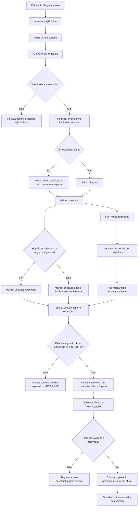
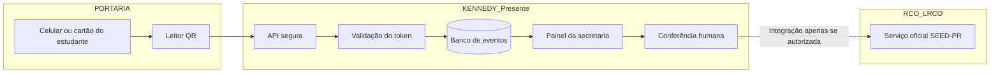
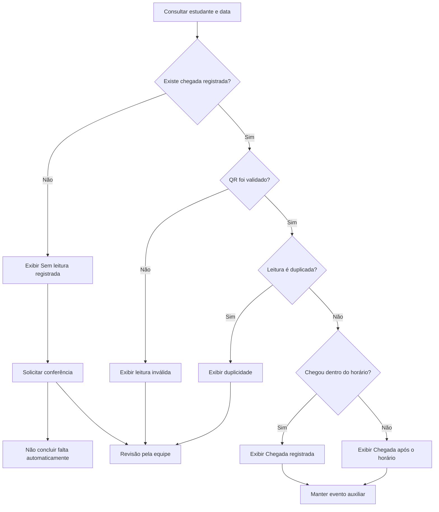

# Diagrama lógico — Kennedy Presente e RCO/LRCO

> Documento separado dos arquivos do sistema, do protótipo e dos planejamentos. O fluxo representa a arquitetura pretendida. A integração com o RCO/LRCO permanece condicional à autorização e à documentação oficial da SEED-PR.

## 1. Diagrama principal

## 2. Fluxo de dados e responsabilidades

## 3. Regras lógicas fundamentais

1. **QR válido:** o servidor localiza um token ativo e associa o evento ao cadastro interno correto.
2. **Horário:** a hora é gerada pelo servidor, não pelo relógio do celular do estudante.
3. **Duplicidade:** leituras repetidas dentro da janela definida pela escola são sinalizadas e não devem gerar múltiplas chegadas.
4. **Atraso:** a classificação depende do horário oficial do turno e da tolerância aprovada pela escola.
5. **Sem leitura:** significa apenas que não existe evento de QR registrado. Não significa falta confirmada.
6. **Presença em aula:** uma chegada na portaria não prova presença em todas as aulas do dia.
7. **RCO/LRCO:** não enviar ou alterar frequência sem API/mecanismo oficial, autorização formal e homologação.
8. **Auditoria:** toda operação administrativa ou integração autorizada deve ter registro de quem/qual serviço executou, quando e qual foi o resultado.

## 4. Estados exibidos no painel

| Estado | Significado |
|---|---|
| Chegada registrada | QR válido lido e evento salvo |
| Chegada após o horário | Evento salvo depois do limite definido |
| Sem leitura registrada | Nenhum evento encontrado; não confirma falta |
| QR inválido/bloqueado | Token não autorizado ou desativado |
| Leitura duplicada | Repetição identificada |
| Aguardando conferência | Exceção precisa ser analisada pela equipe |
| Frequência oficial | Informação proveniente do RCO/LRCO por meio autorizado |

## 5. Diagrama de decisão para o painel

## 6. Cenário fictício de exemplo

Configuração ilustrativa, não é horário oficial da escola:
- início do turno: 07:30;
- tolerância ilustrativa: 10 minutos;
- leitura às 07:22: chegada registrada dentro do horário;
- leitura às 07:36: chegada registrada dentro da tolerância configurada;
- leitura às 07:48: chegada após o horário, para conferência;
- nenhuma leitura: sem leitura registrada, sem concluir falta.

## 7. Limites e aprovação

Este diagrama descreve o funcionamento proposto para o Kennedy Presente. A parte de portaria e painel pode ser simulada com estudantes fictícios. A integração de leitura ou escrita no RCO/LRCO só poderá ser desenvolvida após a SEED-PR confirmar formalmente o mecanismo permitido, fornecer documentação e autorizar o uso. O fluxo oficial de frequência da rede deve continuar sendo respeitado.
